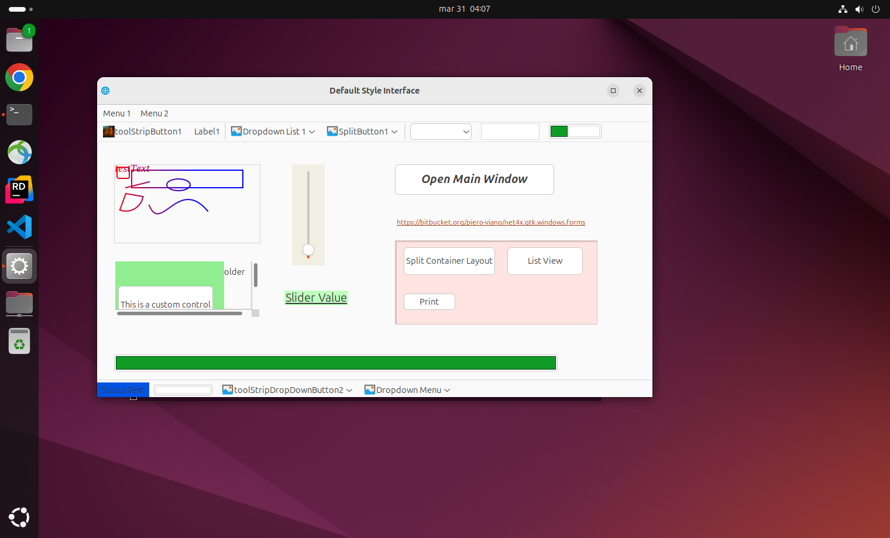
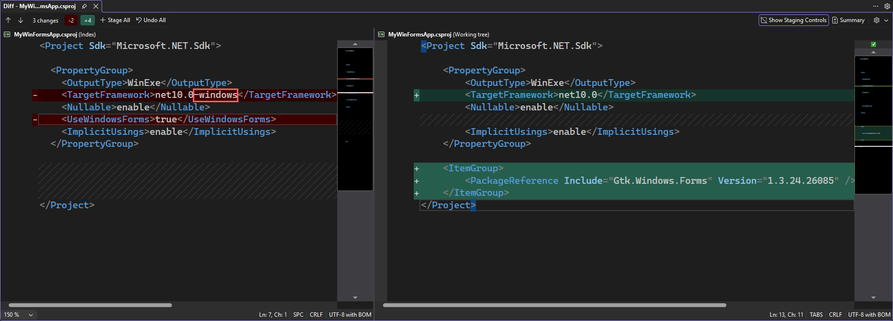
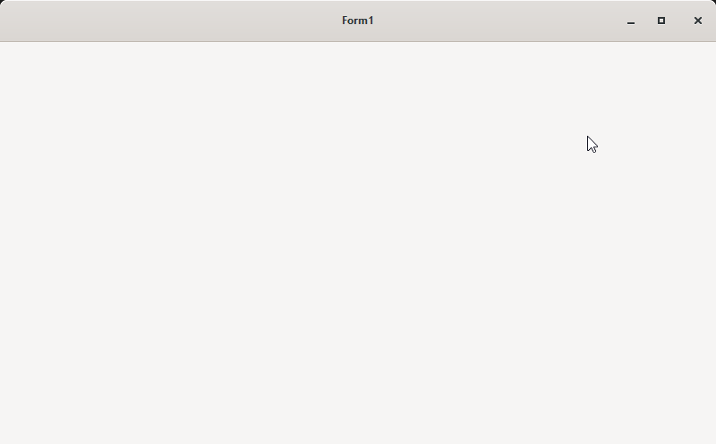

# The Gtk.Windows.Forms framework.





## Introduction

In today's diverse technology landscape, users interact with applications across multiple desktop operating systems, including Windows, macOS, Linux. 
Building a cross-platform user interface (UI) allows developers to create applications that work seamlessly across these environments using a shared codebase.

## Key Benefits

### 1. Reduced Development Time

Instead of building separate UIs for each platform, developers write code once and reuse it across platforms. This significantly speeds up development.

### 2. Lower Maintenance Costs

Bug fixes and updates can be applied in one place, rather than duplicated across multiple platform-specific codebases.

### 3. Consistent User Experience

A unified UI ensures that users have a familiar experience regardless of the device they use.

### 4. Wider Reach

Applications can be deployed to more platforms, increasing the potential user base.

## Detailing the library

Gtk.Windows.Forms allows native Visual Studio development without learning curve.
It's a cross-platform (Windows, Linux, macOS) C# desktop application framework based on GTK components.
Using this framework, projects can be developed in Visual Studio with the native C# WinForms designer, using the same properties, methods, and events as standard WinForms. Development is done entirely with familiar C# techniques — no additional learning required.

Compile once and run across platforms.
It makes cross-platform WinForms application development easy and enables existing C# WinForms applications to be upgraded to cross-platform applications with minimal effort.

### Project website:

The project repository is:

- [Gtk.Windows.Forms](https://bitbucket.org/piero-viano/Net4x.Gtk.Windows.Forms)

### Based on GTKSystem.Windows.Forms:

It was developed originally here:

- [gtkapp](https://www.gtkapp.com)
- [gitee](https://gitee.com/easywebfactory/gtksystem-windows-forms)
- [github](https://github.com/easywebfactory/gtksystem-windows-forms)

## Project history

The original project was developed by EasyWebFactory and is licensed under the MIT License. 
It has been forked by Piero Viano and maintained, with contributions from the open-source community. 
The project continues to evolve, providing a robust solution for cross-platform desktop application development using C#.

The original library was written in Chinese (comments, Xml documentation, etc.), and has been translated into English for broader accessibility.
Many errors and messages are now multi language (Chinese, English, French, German, Italian, Spanish are the actually supported languages).

Many Windows Forms controls are supported, even if their implementation is not 100% complete. The most commonly used controls are fully supported, and the project continues to evolve with contributions from the community.

The library uses Dotnet Standard 2.0 and can be used independently of the .Net version (5.0 or above). Having chosen to not being paired to a .Net version ensures thaat we are not tied to obsolete/not any more supported .Net versions.

The initial implementation was done creating a 'fork' in github of the original repository, but this was demonstrated an un-practical solution because in that time period, EasyWebFactory was developing actively the library and the number of appeared conflict was very high on every sync from the original repository, so we decided to change the approach.

To allow an easy import of the original library evolution, we choose the approach of creating the forked solution (in bitcucket.org) starting from the original git repository (even if we noted that, int he moment of wrinting this, the original development is not producing any more update from many months). Basically, we have added the original repository as a submodule of this repository. The 'preparation' consist in many steps that:

- Convert the original files to UTF8 encoding (when needed) to avoid unreadable Chinese ideograms.
- Translate the original Chinese phrases in English ones.
- Use multi language resources to allow having multi language strings/messages.
- Apply some patches to the original code.
- Reorganaze files in a more convenient file structure.
- Ensures that publicly visible members have Xml documentation.
- Use Roslyn rewriters to ensure that classes respect well known principles.
- Reformat the code

To consent continous development, every 'important' modification is converted to a git ".patch" file.
After having prepared the code, all '.patch' files are applied. In this way, even if EasyWebFactory makes modifications in the original branch, we car re-create our repository starting from the original one and align all modifications in an easy way.

## Issues found in the original Project

One of the main problems of the original project was the total lack of unit testing, making the development very error prone in the evolution.
My main goal is to add unit testing, even if the project is not yet complete, to avoid introducing new bugs in the evolution of the project.
Having introduced unit testing, I will be able to refactor the code, improving its structure and maintainability, without fear of breaking existing functionality. This will allow the project to evolve more rapidly and with greater confidence in the stability of the codebase.

## How Gtk.Windows.Forms uses GtkSharp to emulate Windows Forms

Gtk.Windows.Forms is a compatibility layer that reproduces the Windows Forms API on top of GTK (via GtkSharp). It lets existing WinForms code run with minimal changes by mapping WinForms concepts to GTK widgets and behaviors.

### Core idea

- GtkSharp provides .NET bindings for GTK native widgets.
- Gtk.Windows.Forms implements WinForms-style types and members (namespaces like `GtkSystem.Windows.Forms` / `GtkSystem.Windows.Forms.GtkControls`) and internally uses GtkSharp widgets to implement them.
- The library exposes familiar WinForms classes, properties, events and layout semantics so existing forms and controls require little or no rewrite.

### Typical mapping

- High-level WinForms control classes are implemented as wrappers or adapters around GtkSharp widgets:
  - `RichTextBoxBase` -> uses `Gtk.TextView` internally (`internal Gtk.TextView TextView = new Gtk.TextView();`) to provide rich-text editing.
  - Container/layout controls (e.g., `TableLayoutPanel`) map to GTK containers and implement the WinForms layout rules.
  - Drawing/graphics APIs rely on GTK drawing primitives, with adapters for `System.Drawing`-style usage where possible.

### Event and behavior translation

- WinForms event patterns (delegate signatures, `EventArgs` types) are preserved in public APIs.
- Internally the library subscribes to GTK signals and translates them into WinForms events, converting parameters and raising compatible delegate invocations.
- Input, focus, keyboard and mouse semantics are translated so that common WinForms behavior (tab order, keyboard shortcuts, mouse capture) works on GTK.

### Layout and rendering

- Layout: the compatibility layer implements WinForms layout rules on top of GTK container measurement/allocate phases so controls sized and docked similarly to WinForms.
- Rendering: where code uses `System.Drawing`, the library either adapts to GTK drawing or provides shims that emulate expected behavior. Custom painting is forwarded or translated to the underlying GTK draw cycle.

### Interop and resources

- GtkSharp handles native GTK interop and lifecycle (widget creation, disposal).
- Gtk.Windows.Forms manages mapping of resources, serialization helpers and design-time metadata to match WinForms expectations (so designer-generated code and serialization still make sense).

### When to use

- Porting a WinForms app to cross-platform: minimal API changes required.
- Keeping the same development workflow (Visual Studio, forms designer) while targeting Linux/macOS/Windows with GTK.

## Image resources in Net4x.Gtk.Windows.Forms

This chapter explains how image resources are organized, embedded and used at runtime in `Gtk.Windows.Forms`.

### Where images live in the repo and how they're embedded

- Image files used by the library are included under the `Resources` tree (for example `Resources/System/...`).
- These files are added to the project as `EmbeddedResource` entries in the project file (`Net4x.Gtk.Windows.Forms.csproj`). Example entries look like:
  - `<EmbeddedResource Include="Resources\System\view-more.png" />`
  - The csproj already contains many `EmbeddedResource` updates for `Resources\System\*.png` and cursor files.
- Because they are embedded, at runtime images can be loaded from the assembly using the assembly resource name. The resource name uses the folder dots (e.g. `Resources.System.view-more.png`).

### Typical runtime usage patterns

- Load an embedded image (Gdk.Pixbuf) from the current assembly:
  - `new Gdk.Pixbuf(this.GetType().Assembly, "Resources.System.view-more.png")`
  - This pattern is used in the code to provide a fallback icon when no explicit icon is supplied.
- Use an `Icon` object (the wrapper type in this codebase has fields like `Pixbuf`, `PixbufData`, `FileName`):
  - The `Form.Show()` implementation checks several `Icon` forms and prefers them in order:
    1. `Icon.Pixbuf` (already a `Gdk.Pixbuf`)
    2. `Icon.PixbufData` (byte[] -> `new Gdk.Pixbuf(byteArray)`)
    3. `Icon.FileName` (path on disk -> `SetIconFromFile(path)`)
  - Code example from the project (conceptual):
    - If `this.Icon.Pixbuf != null` → `self.Icon = this.Icon.Pixbuf;`
    - Else if `this.Icon.PixbufData != null` → `self.Icon = new Gdk.Pixbuf(this.Icon.PixbufData);`
    - Else if `this.Icon.FileName != null && File.Exists(this.Icon.FileName)` → `SetIconFromFile(this.Icon.FileName)`.
- Loading images from a `Stream`:
  - For bitmaps: `Image.FromStream(stream)` or `new Gdk.Pixbuf(stream)` (GTK bindings).
  - For icon streams: the codebase provides a helper wrapper `ImageListImage.ImageListImageFromStream(stream, imageIsIcon)` which converts icons to bitmaps when required:
    - If `imageIsIcon == true` → `new Icon(stream).ToBitmap()` is used.
    - Otherwise it creates a `Bitmap` via `Image.FromStream(stream)`.

### How image list items are represented

- The `ImageListImage` type in `System.Windows.Forms.Design` is a small wrapper that exposes common `Image` properties and provides helper factory `ImageListImageFromStream(Stream, bool imageIsIcon)`. This ensures:
  - Icon streams can be converted to bitmaps for use in image lists.
  - Designers / collection editors see familiar image-like properties.

### Project packaging and distribution

- Embedded image resources are packaged with the library when the NuGet package is produced because they are `EmbeddedResource` items in the csproj.
- The project includes explicit `EmbeddedResource` and `None` configuration lines for many resources; keep the `EmbeddedResource` entry for any file you want included in the assembly.

### Practical tips & best practices

- Prefer small PNGs (or SVG where supported) for UI icons. PNG is already used throughout the project.
- Follow the existing resource naming convention and folder structure; runtime code expects assembly resource names like `Resources.System.<filename>`.
- When adding or replacing assets:
  1. Put the file under `Resources/System/` (or the same folder convention used in the project).
  2. Ensure the csproj includes it as `<EmbeddedResource Include="Resources\System\<name>" />` (the project already has `EmbeddedResource` update patterns for the `Resources/System` folder — match the existing style).
  3. Rebuild; load via `new Gdk.Pixbuf(typeof(SomeType).Assembly, "Resources.System.<name>")`.
- When providing an `Icon` programmatically, set one of the supported forms so `Form.Show()` can pick it up:
  - `Icon.Pixbuf` (preferred),
  - `Icon.PixbufData` (byte[]),
  - or `Icon.FileName` (filesystem path).

### Example snippets

- Load embedded pixbuf (used as fallback in `Form.Show()`):
  - `self.Icon = new Gdk.Pixbuf(this.GetType().Assembly, "Resources.System.view-more.png");`

- Convert an icon stream to a bitmap (helper shown in `ImageListImage`):
  - `var listImage = ImageListImage.ImageListImageFromStream(stream, imageIsIcon: true);`

- Create Pixbuf from raw bytes:
  - `var pixbuf = new Gdk.Pixbuf(byteArray);`

This should give you a clear view of how images are stored, packaged and consumed in `Net4x.Gtk.Windows.Forms`. If you want, I can add a short example showing how to add a new image resource and reference it from `Form.Show()` end-to-end.

## Using Gtk.Windows.Forms in application development:

- Create a new Windows Forms App project (for example, GtkWinFormsApp_Win).
- After the project is created, add a package reference to Gtk.Windows.Forms.
- Enable Show All Files and add all forms and user controls to the project.
- Compile and run the project.
- Fix any issues if they appear.

### Note:

If you do build it and Visual Studio displays errors that affect the form designer, simply restart the project to resolve the issue.

## Tutorial regarding creating a new Gtk.Windows.Forms application:
This tutorial is avalilable in this [repository](https://bitbucket.org/piero-viano/net4x.gtk.windows.forms.tutorial/src/master/) with the various main steps in the history


### 1. Install the .NET SDK

Make sure you have the .NET SDK installed (6.0, 7.0, or later). You can check by running:

```
dotnet --version
```

If you don’t have it, download it from [Microsoft](https://dotnet.microsoft.com/en-us/download)

### 2️. Create a new Windows Forms project

From the command line, navigate to the folder where you want your project, then run:

```
dotnet new winforms -n MyWinFormsApp
```

Explanation:

winforms → project template for Windows Forms.
-n MyWinFormsApp → sets the project name and folder.

### 3. Open the created project in Visual Studio:

```
cd MyWinFormsApp
devenv MyWinFormsApp.csproj
```

### 4. Edit the project file and add a reference to Gtk.Windows.Forms

Adding the package reference to Gtk.Windows.Forms in the .csproj file:

```
    <ItemGroup>
		<PackageReference Include="Gtk.Windows.Forms" Version="1.3.24.26085" />
	</ItemGroup>
```
### 5. Remove `<UseWindowsForms>true</UseWindowsForms>` and replace `netX.0-windows` with `netX.0` in the `<TargetFramework>` element of the .csproj file to make it cross-platform compatible.



### 6. Restore nuget packages:

```
dotnet restore
```

### 7. Run the application

