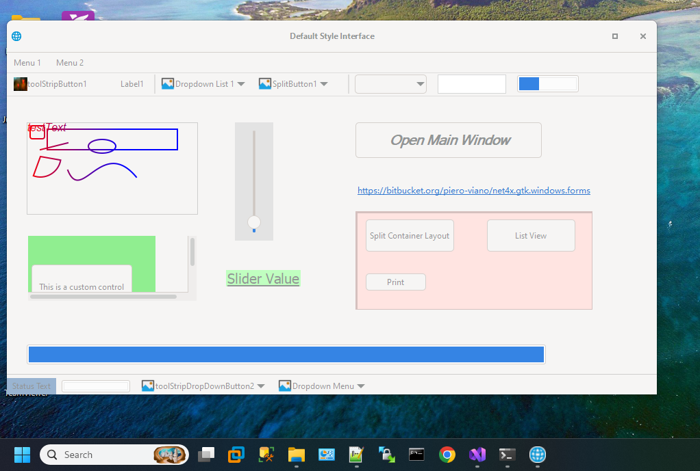
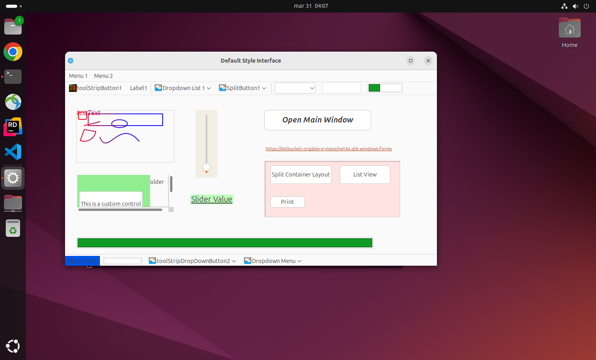
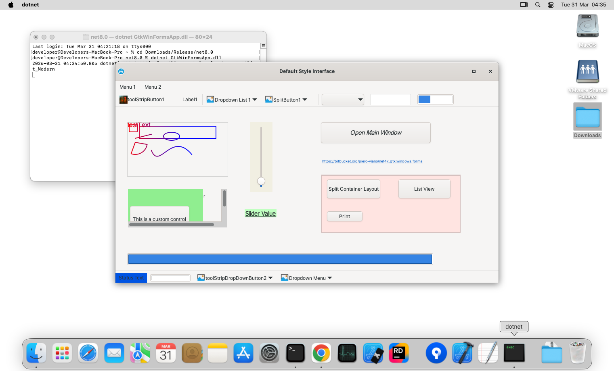

# Gtk.Windows.Forms — Documentation

`Gtk.Windows.Forms` is a WinForms-compatibility layer built on GTK (via GtkSharp): existing C# WinForms
apps compile once and run cross-platform (Windows, Linux, macOS), with the native Visual Studio WinForms
designer.

This page indexes the documentation in this folder.

## Contents

- [Gtk.Windows.Forms framework](./GtkWindowsForms.md) — Overview: benefits, how the library emulates
  WinForms on top of GTK, how image resources work, and a step-by-step tutorial for building an app.
- [Article: Running Windows Forms on Windows, Linux and macOS](./Gtk.Windows.Forms.Article.md) —
  Long-form introduction to the framework and the problem it solves.
- [Architecture](./Architecture.md) — Runtime architecture of the product libraries and how the pieces
  fit together.
- [API completeness](./API-COMPLETENESS.md) — Metadata-measured gap to `System.Windows.Forms` /
  `System.Drawing`; lists what is still missing.
- [Emulation gaps](./EMULATION-GAPS.md) — Where behaviour differs from `System.Windows.Forms` /
  `System.Drawing`, including the non-goals that will not be implemented.
- [Gtk.Resources.Extensions](./Gtk.Resources.Extensions.md) — The companion `System.Resources.Extensions`
  assembly and how `.resx` resources are read without the BinaryFormatter.
